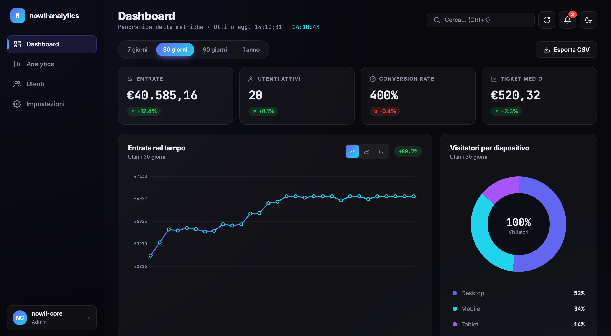

# Analytics Dashboard

<p align="center">
  <b>A Web Analytics Platform for Visualizing Financial KPIs and Business Metrics, Built Entirely in Vanilla JavaScript and the Canvas 2D API Without External Frameworks or Graphic Libraries</b>
</p>

<p align="center">
  <a href="https://github.com/nowii-core/Dashboard/actions/workflows/ci.yml">
    
  </a>
  <a href="https://github.com/nowii-core/Dashboard/blob/main/LICENSE">
    
  </a>
  
  
  
</p>

<p align="center">
  <a href="#-overview">Overview</a> •
  <a href="#-key-features">Features</a> •
  <a href="#-tech-stack">Tech Stack</a> •
  <a href="#-project-architecture">Architecture</a> •
  <a href="#-quick-start">Quick Start</a> •
  <a href="#-contact">Contact</a>
</p>

---

</div>

## Overview

**Analytics Dashboard** is a modern, high-performance web application designed to provide clear and immediate visualizations of financial KPIs and business metrics. Developed entirely with Vanilla JavaScript and native HTML5 Canvas, it completely eliminates the need for heavy external charting libraries (such as Chart.js or D3.js), ensuring lightning-fast loading times, zero dependencies, and a seamless user experience.

---

## Preview



> **Live Demo:** [nowii-core.github.io/Dashboard/dashboard/](https://nowii-core.github.io/Dashboard/dashboard/)

---

## Key Features

- **Dynamic KPI Indicators:** Summary cards featuring real-time percentage delta calculations and animated state transitions.
- **Interactive Line Chart:** Custom rendering via the Canvas 2D API for tracking trends, complete with a time range selector (7, 30, and 90 days).
- **Donut Chart:** Visual representation of data distribution paired with a dynamically coordinated legend.
- **Transaction Log:** Detailed data table for monitoring flows, utilizing visual indicators based on operational status.
- **Responsive Design:** A flexible user interface that adapts seamlessly to any desktop or mobile resolution.
- **Zero Dependencies:** No external libraries are used, guaranteeing maximum efficiency, security, and minimal load times.

---

## Tech Stack

### Frontend
- **HTML5:** Semantic structure.
- **CSS3:** Advanced layout using Flexbox, CSS Grid, and Custom Properties (CSS Variables).

### Graphic Engine
- **JavaScript (ES6+):** Native logic and data manipulation.
- **Canvas 2D API:** High-performance custom rendering for complex data visualizations.

### Optimization
- **Retina Display Ready:** Dynamic management via `devicePixelRatio` to ensure razor-sharp rendering on HiDPI and high-resolution displays.

---

## Project Architecture

```
Dashboard/
├── .github/                 # Issue/PR templates and CI/CD workflows
├── dashboard/               # Core application source files
│   ├── assets/              # Icons, graphics, and static resources
│   ├── css/                 # Modular stylesheets and variables
│   └── js/                  # Canvas rendering logic, data engine, and UI
├── Screenshot-1.png         # Application preview image
├── README.md                # Project documentation
└── index.html               # Main application entry point
```

---

## Quick Start

### Prerequisites
No build step or package manager is required. The application runs natively in the browser.

### Installation

1. **Clone the repository:**
   ```bash
   git clone https://github.com/nowii-core/Dashboard.git
   cd Dashboard
   ```

2. **Run the application:**
   Open the `index.html` file located in the `dashboard/` directory in your preferred modern web browser. For the best development experience, you can use a local development server (e.g., VS Code Live Server extension or Python's `http.server`) to view the dashboard.

---

## License

This project is distributed under the **MIT** license. See the [`LICENSE`](./LICENSE) file for more information.

---

## Contact & Support

- **Maintainer:** [@nowii-core](https://github.com/nowii-core)
- **Bug Reports & Feature Requests:** If you encounter an issue or would like to suggest an improvement, open an [Issue](https://github.com/nowii-core/Dashboard/issues) or submit a [Pull Request](https://github.com/nowii-core/Dashboard/pulls).

---

<div align="center">
  <sub>Developed by <b>nowii-core</b></sub>
</div>
